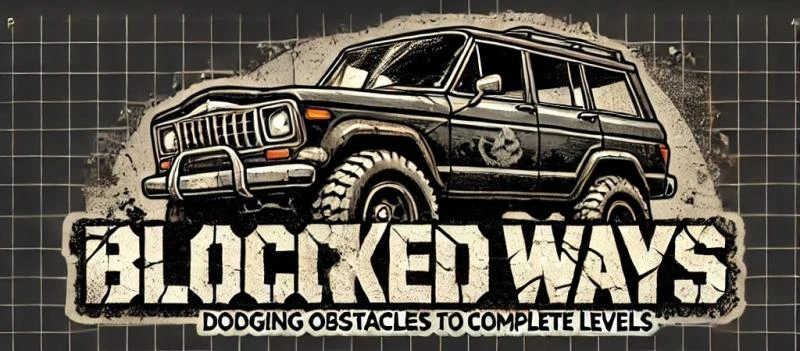
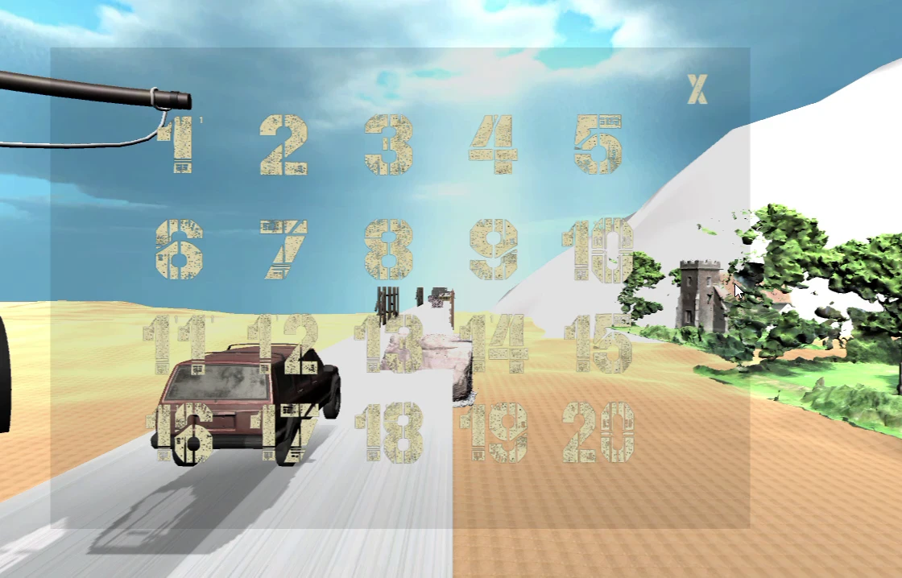
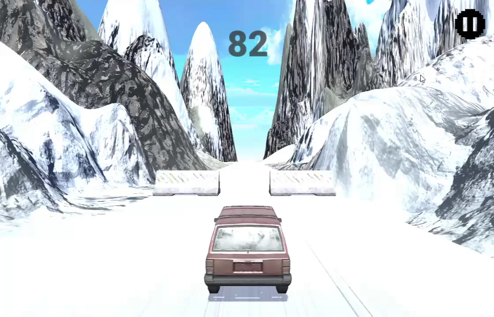

# Blocked Ways

Blocked Ways is a 3D obstacle-course driving game with 40 levels, level selection, progress-based level locking and pause controls. It was built in Unity in 2021 and updated in 2024, and this source release is for developers who want to inspect its gameplay and progression logic.

## What it does

- Moves the player's vehicle forward while keyboard or on-screen controls steer and jump.
- Presents 40 playable levels in the Unity build order.
- Unlocks level buttons as the player reaches each finish trigger.
- Pauses, resumes, restarts or exits a level through an in-game menu.
- Restarts the current scene after the vehicle hits an obstacle or leaves the course.

## How the progress logic works

`EndTrigger` stores the next unlocked build index in Unity's `PlayerPrefs` after a completed level. `LevelLocker` reads that value when the level-select screen opens and disables buttons beyond the player's progress. `LevelDoder` handles asynchronous scene loading and updates the loading bar, while `PauseScreem` controls time scale and the pause-menu scene transitions.

## Stack

- Unity 2019.4.18f1
- C# and Unity physics
- Unity UI, `SceneManager` and `PlayerPrefs`

## Gameplay

https://github.com/user-attachments/assets/dbb274e5-928a-46e5-b8c3-7222beec274f

## Run it locally

1. Install Unity Hub and Unity 2019.4.18f1.
2. Clone this repository and add its folder as a Unity project.
3. Open `Assets/Scenes/Game Loader.unity` and enter Play mode.

This public copy preserves the C# scripts, scene layouts, prefabs and animations. The original project used third-party models, textures, skyboxes, fonts and audio that are not redistributed here, so Unity will report missing references until compatible licensed replacements are imported and connected.

## Credits

Built by Ghaleb Mohiuddin Syed. The gameplay stills document the original build. Third-party art and audio packs from that build are not included in this repository.

## Licence

The source code is available under the [MIT Licence](LICENSE). The documentation images are not included in that licence.
